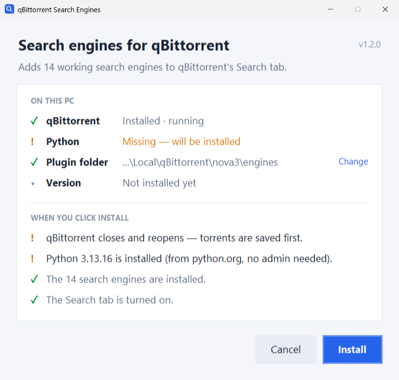
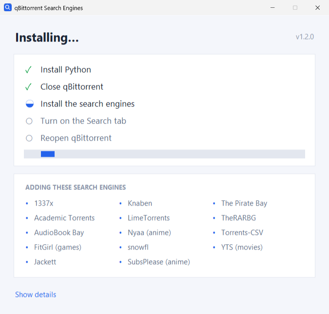
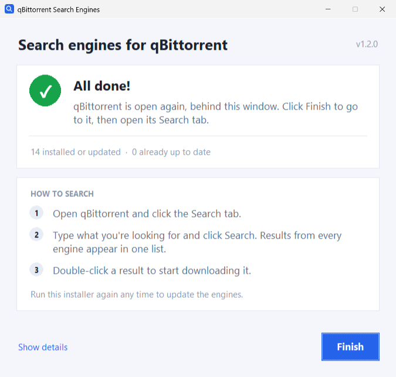

# qBittorrent Search Plugin Installer

Adds a batch of working **search engines** to qBittorrent's *Search* tab —
The Pirate Bay, 1337x, Knaben, TheRARBG, snowfl, YTS, Nyaa, SubsPlease, Anime Tosho, nekoBT, EZTV, Sukebei,
LimeTorrents, Torrents-CSV, Academic Torrents, audiobooks and game repacks —
and sets up everything they need. One download, one double-click.

Every engine is checked against the live site before release; ones that have
gone dead or too slow are dropped rather than left to fail in the Search tab.
The list that is installed, and the reason anything was removed, is at the
top of `install_qbt_plugins.py`. See [CHANGELOG.md](CHANGELOG.md) for what
changed in each version.

<picture>
  <source media="(prefers-color-scheme: dark)" srcset="docs/welcome-dark.png">
  
</picture>

---

## How to install

You need qBittorrent already installed. Nothing else.

1. Download **`qbt-plugin-installer-<version>.exe`** (for example
   `qbt-plugin-installer-1.2.0.exe`) from the
   [Releases page](../../releases/latest).
2. **Double-click it.**
3. Windows may show a blue **"Windows protected your PC"** box (this happens
   with any new app that isn't signed by a big company). Click
   **More info → Run anyway**.
4. The installer shows what it found on your PC and exactly what it is about
   to do. Click **Install**.
5. When it says **All done**, open qBittorrent's **Search** tab.

### What the installer does for you

- **Finds qBittorrent's folders by itself**, including portable copies.
- **Installs Python** if it's missing. qBittorrent needs Python to run any
  search plugin. It's the official python.org installer, checked before it
  runs, installed just for your user (no administrator prompt).
- **Turns on the Search tab.** qBittorrent hides it by default.
- **Closes and reopens qBittorrent** if it's running, so the new engines show
  up. It saves your torrents first, exactly like choosing *Exit*, so nothing
  is lost. You are told before this happens.
- **Checks every engine starts**, and tells you if your network blocks any
  of the sites (a DNS filter like Pi-hole or NextDNS, a VPN or your internet
  provider can do that, and the engine then finds nothing).

### Need help?

The last screen has a **Copy log** link: paste what it copies into your
question or bug report. The same log is saved as `qbt-plugin-installer.log`
in qBittorrent's plugin folder.

### Already installed an older version?

Run the new one. It updates every engine, removes ones that have died, and
tells you which version it's upgrading from.

<p>
<picture>
  <source media="(prefers-color-scheme: dark)" srcset="docs/installing-dark.png">
  
</picture>
<picture>
  <source media="(prefers-color-scheme: dark)" srcset="docs/done-dark.png">
  
</picture>
</p>

### Update notices

When a new version of this installer comes out, you'll see it in qBittorrent:
your searches get one extra result at the top, **"⬆ Update available"**.
Double-click it and the new installer downloads and opens; click **Install**
as usual. (If the download fails, the download page opens instead.) It shows
up in the engine list as *Installer updates*; it isn't a torrent site.

To know about new versions, it asks this project's GitHub page at most once a
day. Like visiting any web page, that shows GitHub your IP address. Nothing
else is sent, and nothing is downloaded until you double-click the notice. The
download is checked against GitHub's published checksum before it runs, and
deleted afterwards. To turn the notices off, untick *Installer updates* in
**Search plugins…**.

**Don't use "Check for updates" in qBittorrent's Search plugins window.**
It reinstalls qBittorrent's own engines that this installer removed because
they no longer work. If you already did, run the installer again to clean up.

### Removing engines

To remove all of them, run the installer and click **Remove engines…** at
the bottom left of its first screen. It removes only what this installer
added: engines you installed some other way stay, and so do your torrents
and qBittorrent's settings.

To remove just one engine:

1. Open qBittorrent and click the **Search** tab.
2. Click **Search plugins…** (bottom right).
3. Select the engines you don't want (hold **Ctrl** to pick several) and
   click **Uninstall**.

Running the installer again puts them all back. Python stays installed; if
nothing else on your PC uses it, you can remove it like any other program in
Windows **Settings → Apps → Installed apps** (it's listed as *Python 3.13*).
To hide the Search tab again, untick **View → Search Engine** in qBittorrent.

---

## For developers / advanced users

The `.exe` is the GUI (`qbt_installer_gui.py`), a thin front end over
`install_qbt_plugins.py`, which also runs on its own as a command-line tool:

```bash
python install_qbt_plugins.py            # install everything (asks before closing qBittorrent)
python install_qbt_plugins.py --dry-run  # preview, change nothing
python install_qbt_plugins.py --yes      # don't ask first
python install_qbt_plugins.py --no-restart  # leave a running qBittorrent alone
python install_qbt_plugins.py --force    # also rewrite unchanged files + nova3 framework
python install_qbt_plugins.py --uninstall  # remove the engines this installer added
python install_qbt_plugins.py --help     # all options
python qbt_installer_gui.py              # the GUI, from source
```

`Install qBittorrent Plugins.bat` runs the command-line version from a source
checkout. It needs Python already installed.

### Build the `.exe` yourself

```bat
build_exe.bat
```

Output lands in `dist\qbt-plugin-installer-<version>.exe`, named after
`__version__`. The
[GitHub Actions workflow](.github/workflows/build.yml) builds the same `.exe` on
every `v*` tag and attaches it to a Release automatically. The tag must match
`__version__` in `install_qbt_plugins.py`.

### What gets installed

The installer copies the [`qbt_plugins/`](qbt_plugins) custom plugins and
downloads a curated set of community plugins into qBittorrent's
`nova3/engines` directory, then auto-installs any third-party Python packages a
plugin needs (currently none — all are standard-library only), and finally
starts every engine under the Python qBittorrent will use to confirm it
loads. See the header of [`install_qbt_plugins.py`](install_qbt_plugins.py)
for the full verified list.

Every downloaded file is pinned to an upstream commit and its SHA-256, so
users get exactly what was tested. To move the pins forward, run
`python tools/refresh_pins.py`, read the diffs it prints, then rerun it with
`--write` and test the changed engines.

### Tests and health checks

```bash
python -m pip install pytest
python -m pytest                 # offline unit tests (also run in CI)
python tools/health_check.py     # search with every installed engine
```

CI builds and smoke-tests the `.exe` on every push to `main`. Every Monday
[`health.yml`](.github/workflows/health.yml) searches with every engine and
compares the pins with upstream; when something needs attention it opens
(or reopens) an issue labelled `engine-health`, and closes it when all is
well again.
